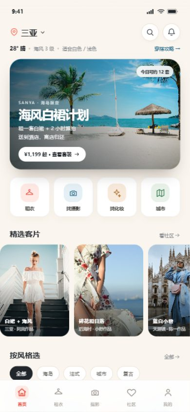
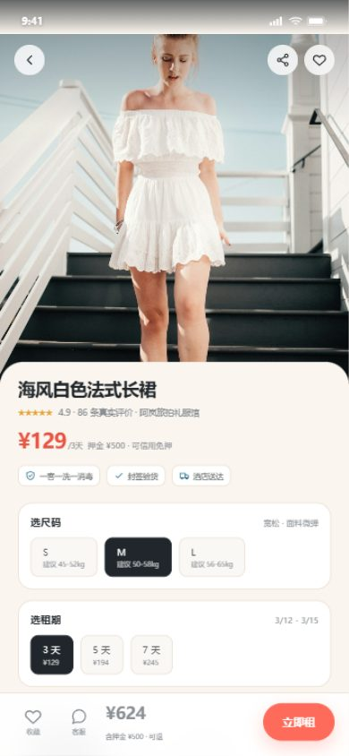
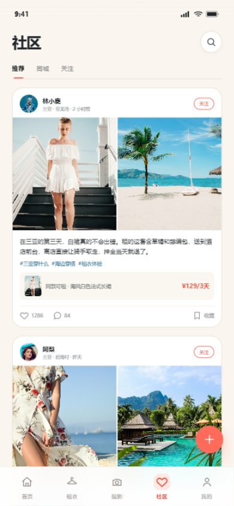

# 未命名项目 · 前端交互原型

这是「未命名项目」旅行拍照租衣平台的第一版前端原型，用手机外壳模拟小程序/App 的浏览与下单体验。

> `public/` 是 Cloudflare Pages 的发布目录；`docs/` 只放策划文档，不参与前端构建。

## 运行

Windows 下可以直接双击 `start.bat`，它会启动本地服务器并打开浏览器。

也可以手动在仓库根目录启动一个静态服务器：

```bash
python -m http.server 4173 -d public
```

然后打开：

```text
http://127.0.0.1:4173
```

> 直接双击 `index.html` 也可以打开，但建议用本地服务器，图片和路径更稳定。

## 预览

| 首页 | 商品详情 | 社区 |
| --- | --- | --- |
|  |  |  |

## 已实现的页面

| 页面 | 说明 |
| --- | --- |
| 首页 | 定位、天气、主视觉、四大入口、精选客片、风格筛选、热门可租 |
| 租衣列表 | 搜索、日期、风格筛选、商品双列 |
| 商品详情 | 图片轮播、尺码、租期、配送方式、模特信息、真实客片、费用规则 |
| 确认订单 | 酒店地址、租期时间轴、费用明细、安心险、协议 |
| 支付弹层 | 微信支付模拟、金额、押金说明 |
| 支付成功 | 订单摘要、查看订单、返回首页 |
| 订单列表 | 全部/租衣/摄影筛选 |
| 订单详情 | 状态、进度时间轴、物流/服务信息、押金、售后 |
| 找摄影 | 摄影师列表、风格筛选、作品封面、评分、价格 |
| 摄影师详情 | 作品集、套餐、档期、定金预约 |
| 找化妆 | 妆造师列表、风格、价格、预约 |
| 城市 | 三亚机位、酒店、3 天穿搭路线 |
| 社区 | 推荐/同城/关注、图文客片、同款挂载、点赞 |
| 我的 | 用户资料、会员、订单快捷入口、收藏/身材档案等 |

## 可交互的点

- 底部 5 个 Tab：首页 / 租衣 / 摄影 / 社区 / 我的
- 首页「租衣 / 找摄影 / 找化妆 / 城市」四个入口
- 点商品 → 详情 → 选尺码/租期/配送 → 立即租 → 确认订单 → 支付 → 成功 → 查看订单
- 点摄影师 → 详情 → 选档期 → 付定金 → 成功
- 社区点赞、同款商品跳转
- 风格筛选、订单筛选、城市切换弹层
- 支付弹层、Toast 提示

## 说明

- 数据为演示数据，金额、档期、商家名称均为虚构。
- 图片来自 Unsplash，仅用于原型演示，正式产品需替换为商家授权实拍/客片。
- 这是前端交互原型，不连接真实支付、库存、物流和后台。
- 下一版可以继续做：商家工作台、运营后台、社区发帖、会员中心、真实地图/天气。
